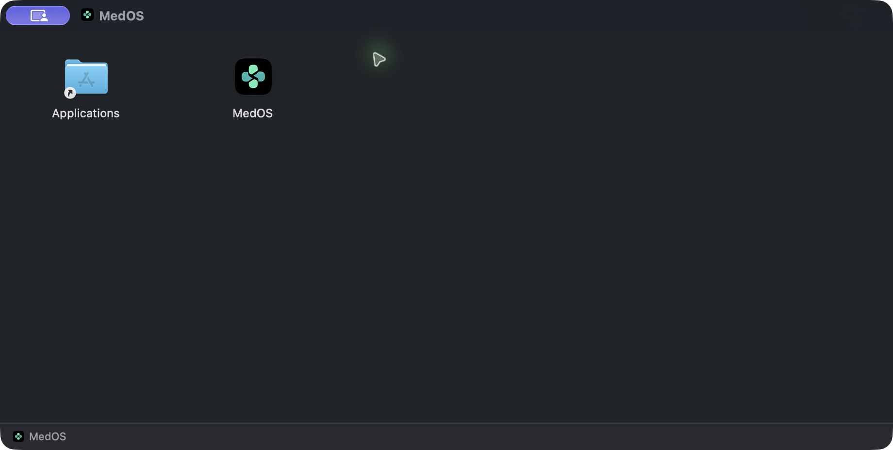
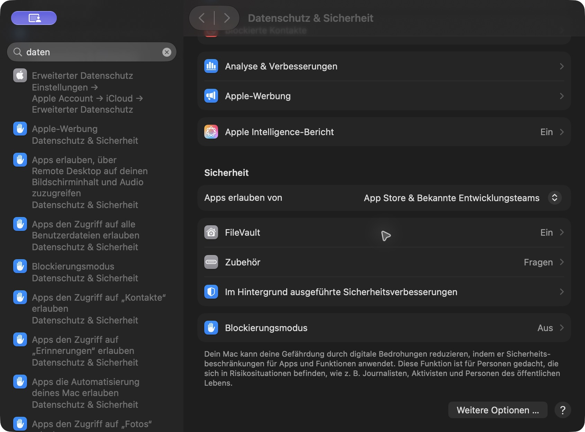

# Installation und Updates

## macOS

### 1. MedOS installieren

Lade in den [Releases](../../../releases) die DMG-Datei für deinen Mac:

- **Apple Silicon (M1 oder neuer):** `darwin-aarch64`
- **Intel:** `darwin-x86_64`

Welchen Mac du hast, siehst du unter  → Über diesen Mac.

Öffne die DMG und ziehe **MedOS** auf den Ordner **Applications**.

### 2. MedOS zum ersten Mal öffnen

Öffne MedOS im Ordner Programme. Beim ersten Start meldet macOS, dass MedOS nicht überprüft werden kann. Das liegt daran, dass MedOS nicht über Apple verteilt wird. Klicke auf **Fertig**.

### 3. MedOS erlauben

Öffne **Systemeinstellungen → Datenschutz & Sicherheit** und scrolle nach unten zu **Sicherheit**. Dort steht jetzt ein Hinweis zu MedOS. Klicke auf **Dennoch öffnen** und bestätige mit deinem Passwort oder Touch ID.

Fertig. Ab jetzt startet MedOS ganz normal, auch nach Updates.

**Kein „Dennoch öffnen“ zu sehen?** Öffne MedOS noch einmal aus dem Ordner Programme und schau danach erneut in die Einstellungen.

## Windows

Für Windows gibt es noch keine Beta.

## Updates

MedOS sucht beim Start und danach alle sechs Stunden nach einer neuen Version (abschaltbar unter Einstellungen › Über MedOS). Gibt es eine, steht unten links im Navigator ein Hinweis:

1. **Was ist neu** zeigt, was die Version bringt.
2. **Laden** lädt sie mit sichtbarem Fortschritt; du kannst dabei weiterarbeiten.
3. **Neu starten** installiert sie. Deine Arbeit ist gespeichert.

**Überspringen** blendet diese Version aus, **Später** den Hinweis bis zur nächsten Prüfung. Von Hand suchst du unter Einstellungen › Über MedOS › Nach Updates suchen.

Nach dem ersten Update auf die Beta fragt macOS einmal, ob MedOS seine Einträge im Schlüsselbund (die ChatGPT-Anmeldung) weiter nutzen darf. Wähle **Immer erlauben**; danach fragt macOS bei Updates nicht mehr.

Ohne Internetverbindung findet die Prüfung nichts; das heißt nicht, dass du die neueste Version hast. Lade bei Problemen die passende DMG aus den Releases. In einen stabileren Kanal wechselt MedOS mit dem Update selbst (etwa von der Alpha zur ersten Beta); zurück in einen weniger stabilen Kanal kommst du nur, indem du eine Version dieses Kanals bewusst installierst.
